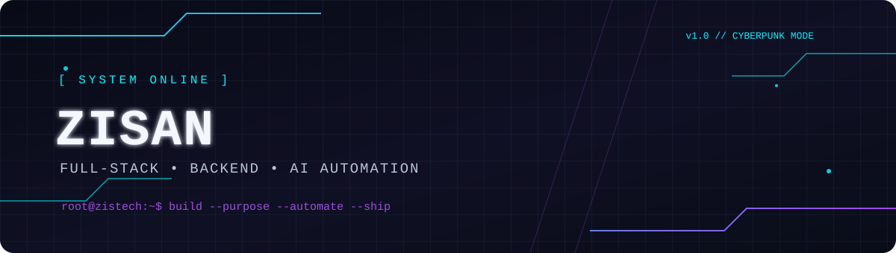

<div align="center">

<!-- Replace this banner with the custom SVG in assets/cyberpunk-banner.svg after uploading it to your profile repository. -->


# `ZISAN.exe` // Zahidul Islam Zisan

### `FULL-STACK DEVELOPER` · `BACKEND ENGINEER` · `AI & AUTOMATION BUILDER`


<p>
  <a href="https://github.com/zisan405"></a>
  <a href="https://www.linkedin.com/in/zahidul-islam-zisan-779311293/"></a>
  
</p>

`[ SYSTEM STATUS: ONLINE ]` &nbsp; ` [ MODE: BUILD • AUTOMATE • SHIP ]`

</div>

---

## `01 // ABOUT_ME`

```text
┌─ OPERATOR PROFILE ───────────────────────────────────────────┐
│ Handle      : Zisan / ZisTech                                 │
│ Role        : Software Developer                              │
│ Focus       : Backend • Full-Stack • AI Integration           │
│ Mission     : Build useful software and automate workflows    │
│ Current mode: Learn → Build → Ship → Improve                  │
└───────────────────────────────────────────────────────────────┘
```

- 🔧 I build web applications, APIs, admin panels, and practical software tools.
- 🧠 Interested in AI integrations that solve real problems—not just demos.
- ⚙️ Exploring workflow automation, SaaS products, and business-focused technology.
- 🌐 Comfortable working across frontend, backend, databases, and deployment workflows.
- 🎯 Always improving system design, code quality, security, and production readiness.

> **Build with purpose. Automate with intent. Ship with confidence.**

## `02 // TECH_STACK`

### Languages & frameworks
<p>
  
</p>

### Data, infrastructure & tools
<p>
  
</p>

### Focus areas
<p>
  
  
  
  
  
</p>

## `03 // FEATURED_BUILDS`

> Pin your best repositories on your GitHub profile. Replace the example repository names below with the exact public repositories you want to showcase.

| Project | What it does | Stack |
|---|---|---|
| **ExpensePulse** | Expense tracking with personalized financial insights and AI-assistant concepts | Flutter · Firebase · AI |
| **Robi Air Overseas** | Travel/visa agency website and management workflows | React · Laravel · MySQL |
| **ZisTech Portfolio** | Personal portfolio and developer showcase | React · Vite |
| **QR Template API** | Template catalogue API and asset delivery backend | Node.js · Express · PostgreSQL |

*Project descriptions are summaries; link each title to its actual repository before publishing if the repository is public.*

## `04 // GITHUB_TELEMETRY`

<div align="center">


</div>

## `05 // CONTRIBUTION_MATRIX`

The snake animation is generated by the included GitHub Actions workflow. After the first successful workflow run, this section should render the generated SVG:

<div align="center">
  <picture>
    <source media="(prefers-color-scheme: dark)" srcset="https://raw.githubusercontent.com/zisan405/zisan405/output/github-contribution-grid-snake-dark.svg">
    <source media="(prefers-color-scheme: light)" srcset="https://raw.githubusercontent.com/zisan405/zisan405/output/github-contribution-grid-snake.svg">
    
  </picture>
</div>

## `06 // CONNECT`

<div align="center">

**Have a useful idea, a backend challenge, or an automation workflow to improve? Let's connect.**

<a href="https://github.com/zisan405"></a>
<a href="https://www.linkedin.com/in/zahidul-islam-zisan-779311293/"></a>

`[ END OF TRANSMISSION ]`

</div>
